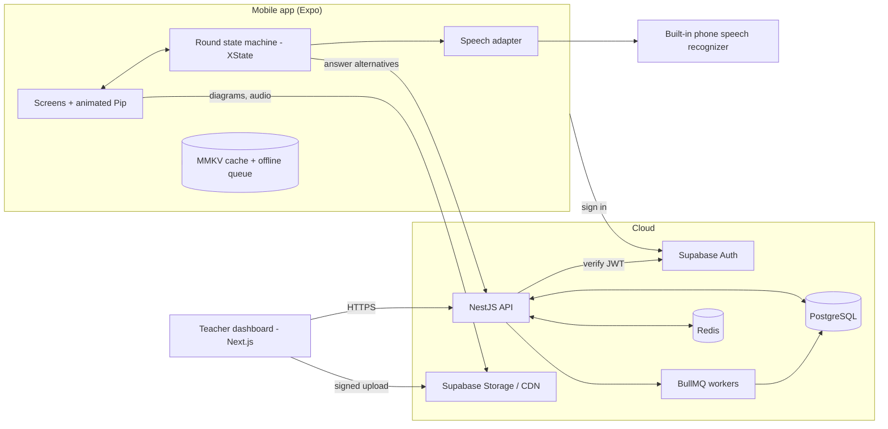
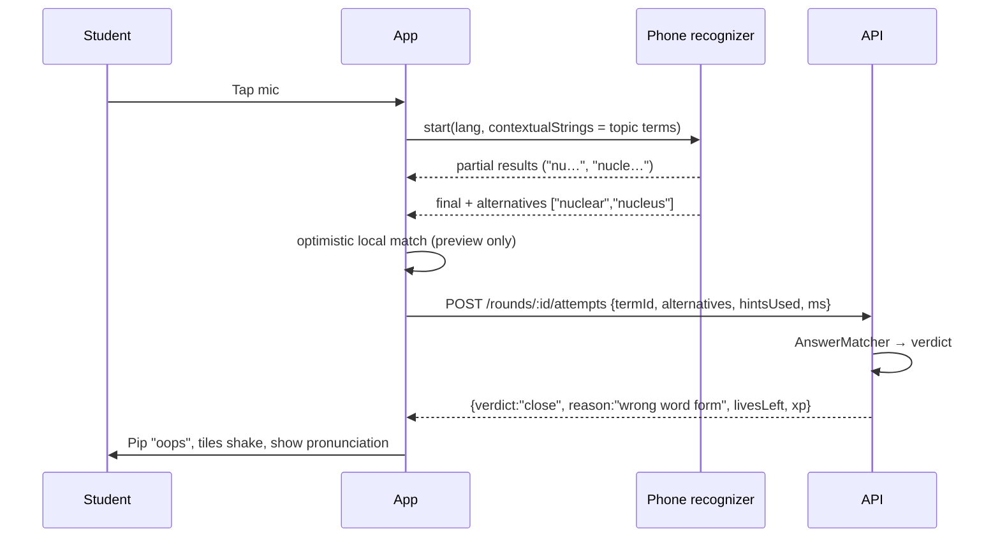
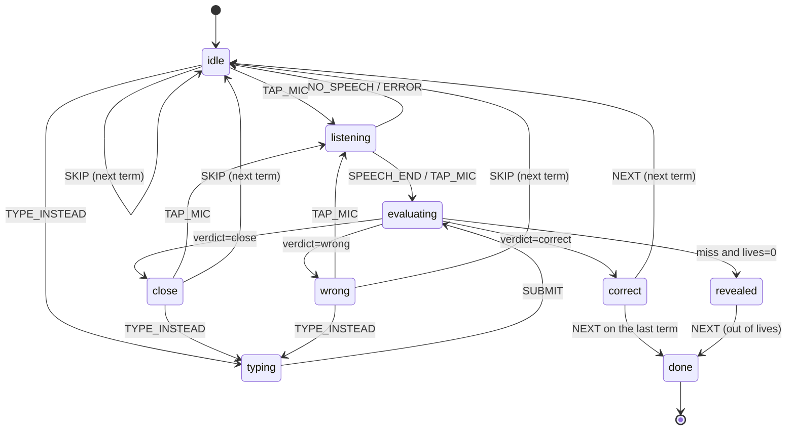

# Architecture

## System overview



**Style: a modular monolith.** There's one API service split into clear modules, not microservices. That's the right size for a small team, and modules can be split out later if one ever needs to scale on its own.

## Round flow



## Round state machine (client)


Pip's mood, the mic look, the bubble copy and the tile style are all **derived** from the current state. No component stores its own copy of the state.

Implementation: `apps/mobile/src/features/play/machine/roundMachine.ts` (XState v5), with view helpers in `roundView.ts`.
- **Lives belong to the round:** 3 per round. A close or wrong answer costs one. When the last one goes, the term is revealed and the round ends.
- **Budgets per round:** 3 hint presses (the first press on a term shows the clue, later ones reveal a letter, and the whole word is never revealed) and 2 skips. HINT and SKIP work in idle, close and wrong. While listening, Type it instead aborts the recognizer.
- **Local scoring (until Phase 3 moves it to the server):** 100 XP for a first try, minus 25 for each hint or miss on that term (minimum 25). The streak counts first-try answers only.
- **Side effects are injected** with `roundMachine.provide()`: the actions `startListening`, `stopListening` and `abortListening`, and the actor `evaluateAnswer`. Phase 2 uses the local matcher; Phase 3 swaps in `POST /rounds/:id/attempts`.
- **Output** when the round ends: `{ score, bestStreak, livesLeft, endedBy: 'complete' | 'out-of-lives' | 'quit', results[] }`, with each term's outcome (`first-try` / `assisted` / `missed` / `skipped`). The Summary screen uses it.

## Mobile folder structure
```
apps/mobile/
  app/                      # Expo Router routes (thin: compose features)
    (tabs)/index.tsx        # Home
    play/[topicId].tsx
    summary/[roundId].tsx
  src/
    theme/                  # tokens.ts, typography.ts, motion.ts: re-export packages/shared/src/theme + RN helpers
    shared/                 # ui kit (Button3D, GlassPanel, Chip, Tile), hooks, api client,
                            #   speech/ = SpeechRecognizer port + native and mock adapters
                            #   mascot/ = Pip.tsx, pipMoods.ts, moodFor.ts (used by Home, Play, Summary)
                            #   session/ = small Zustand stores shared across screens (finished round → Summary)
                            #   scene/ = SceneBackground (day/night SVG + drifting atoms, sparkles), GlassPanel (blur),
                            #            Sunburst, Float, Confetti, Rise
                            #   ui/ = PrimaryButton, Chip, TextButton, icons, Placeholder, ErrorBoundary
    features/
      home/
      play/
        machine/roundMachine.ts
        components/ (Hud, PictureCard, LetterTiles, PipBubble, ControlDock, MicButton, TypeAnswer, FactCard, MicPrimer)
        copy.ts             # Pip's bubble copy and mic labels, derived from the round state
        PlayScreen.tsx
      speech-lab/           # Speech lab screen (Phase 1 spike, developer tool)
      summary/
      topics/
      profile/
```

Routes live in `apps/mobile/app/` (Expo Router uses it because there is no `src/app/`). Import app code with the `@/` alias (`@/theme`, `@/shared/...`, `@/features/...`). ESLint blocks imports from one feature into another. Code that several features use, like speech recognition (Play, Practice, onboarding's mic check) and Pip (Home, Play, Summary), lives in `src/shared/`.

## Shared package
```
packages/shared/src/
  theme/      # brand tokens (the code copy of BRAND.md) + contrast helper
  schemas/    # Zod request/response shapes (DATA_AND_API.md)
  matcher/    # AnswerMatcher (SPEECH_AND_MATCHING.md)
  content/    # bundled term sets, diagrams, topics (Phase 1–2 local content; later the seed data)
  progress/   # level and star rules (the server decides from Phase 3; the app previews)
```
Built with `tsc` to `dist/`, and imported as `@blurt/shared`, `@blurt/shared/theme`, `@blurt/shared/schemas` or `@blurt/shared/matcher`. Turbo builds it before anything that depends on it typechecks, lints, tests or runs.

## API folder structure (NestJS modules)
```
apps/api/src/
  auth/         # JWT guard (Supabase), current-user decorator
  content/      # subjects, topics, terms, diagrams (read-heavy, cached)
  gameplay/     # rounds, attempts, AnswerMatcher
  progress/     # XP, levels, streaks, mastery per term
  leaderboard/  # weekly leagues (Redis sorted sets)
  teacher/      # topics, terms, pictures, classes, reports, import (role: teacher)
  media/        # signed upload URLs, image-processing jobs (sharp), TTS audio jobs
  classes/      # join codes, enrollments, assignments
  admin/        # teacher invites, library promotion, schools (role: admin)
  common/       # filters, interceptors, config, prisma service
```
Built so far: `auth/` (Supabase JWT guard with a swappable `JwtVerifier`, then `RolesGuard` for `@Roles(...)`; roles always come from our database), `users/` (`/me`; the row is created on first sign-in), `content/` (`/subjects`), `gameplay/` (rounds, attempts, skip, finish), `progress/` (XP, level, streak), `common/` and `health/`. The other modules are created in the phase that needs them. Every route needs a Supabase JWT unless it's marked `@Public()`. Request bodies are validated with the shared Zod schemas through Nest's `StandardSchemaValidationPipe`. Rate limits use `@nestjs/throttler`: 300 requests a minute, and 40 a minute for answers. It's in memory for now and moves to Redis in Phase 5.

Tests: services are unit-tested against in-memory repositories (`apps/api/test/fakes.ts`). `test/app.e2e-spec.ts` runs the whole HTTP stack (guards, validation, error shape) with only the token check and the repositories faked.

Inside each module: `controller` (HTTP, DTO validation) → `service` (business rules) → `repository` (Prisma queries). Controllers never call Prisma directly.

## Design patterns used, and where

| Pattern | Where | Why |
|---|---|---|
| **State machine** | `roundMachine` (XState) | The round has strict states. This removes impossible combinations like "listening and correct at once". |
| **Adapter / Port** | `SpeechRecognizer` interface with `NativeSpeechAdapter`, later `CloudSpeechAdapter`, and a `MockSpeechAdapter` for tests | Swap speech engines without touching the UI. |
| **Strategy** | `AnswerMatcher` runs a chain of match strategies (exact → variant → word family → phonetic) | Each rule is small, testable and easy to tune. |
| **Chain of responsibility** | The order of those strategies, with a confusable guard first | The first decisive strategy wins. |
| **Repository** | API data access | Business logic is testable without a database. |
| **Dependency injection** | NestJS providers | Swap implementations (e.g. a test Redis). |
| **Observer / domain events** | `AnswerAccepted` → XP, streak, mastery, leaderboard listeners (Nest EventEmitter, or BullMQ for slow work) | Gameplay doesn't need to know about leagues. |
| **DTO + schema validation** | Shared Zod schemas | One definition of request shapes for app and API. |
| **Offline-first / outbox** | Attempts queued in MMKV when offline, sent on reconnect with idempotency keys | Classrooms often have spotty Wi-Fi. |
| **Container / presentational** | Screens connect the state machine; components only render props | Easy to preview and test the UI. |
| **Role-based access control** | `RolesGuard` + ownership checks in teacher services | Teachers only see and change their own content and classes. |
| **Feature flags** | PostHog | Roll out a cloud speech fallback to a subset of users. |

## Security and fairness
- The server is authoritative for verdicts, XP and lives. The client only previews.
- Rate-limit attempts per user (Redis), and use idempotency keys on attempts.
- Students' voice audio **never leaves the phone** with the native recognizer, and only text alternatives are sent. If you add a cloud speech fallback, ask for consent and don't store recordings by default. This matters for minors, so check your local data privacy law and your school partners' policies.
- Row-level authorization: students only read their own progress and the topics assigned to their classes. Teachers only see their own content and classes.
- Uploaded files are validated by content (not file name), resized, re-encoded to WebP, stripped of EXIF location data, and SVGs are sanitized before anyone sees them.

## Performance targets
- Mic tap to listening UI: < 100 ms. Speech end to verdict: < 400 ms on 4G.
- Cache whole topics (terms + diagrams + audio) when a round starts, so a round can be played without network and synced afterwards.
