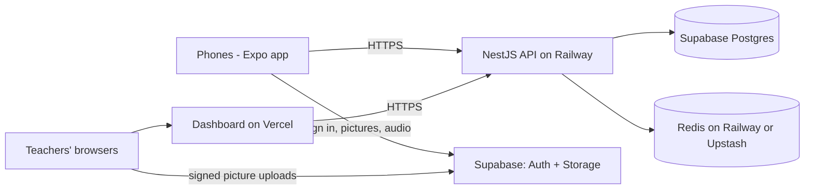

# Deployment

## Yes, the API has to be online
The app runs on students' phones, so anything it talks to must be reachable on the internet: the NestJS API, the database, auth and file storage. Supabase already hosts the database, auth and storage for you. **The only thing you deploy yourself is the NestJS API**, and Railway is a good fit for it.



## Environments
| Environment | Purpose | Where |
|---|---|---|
| Local | Development | API on your computer (`pnpm --filter api start:dev`), a free Supabase dev project, Redis in Docker |
| Staging | Testing builds with real phones before release | Railway service `api-staging` + a separate Supabase project |
| Production | Real students | Railway service `api-prod` + the production Supabase project |

Never point a development build at the production database.

## Deploying the API to Railway

**Ready to go:** `railway.json` at the repo root sets the build (`pnpm turbo run build --filter=api`, which also builds `packages/shared` and generates the Prisma client), the start command (`node apps/api/dist/main.js`), migrations before each deploy (`prisma migrate deploy`) and the `/health` check. In Railway, keep the service's root directory at the **repo root**: the API needs `packages/shared` to build. The steps below explain each part; with `railway.json` you mostly just add the environment variables (step 5).

1. **Health check:** built. `GET /health` returns `{ "ok": true }`.
2. **Build:** no Dockerfile needed. Railway's builder (Railpack) reads `railway.json`, uses Node 22 (`.nvmrc`) and pnpm from `packageManager`, and runs `pnpm turbo run build --filter=api`. The server listens on Railway's `PORT`.
3. **Create a Railway project** → "Deploy from GitHub repo" → select the repo. Leave the service's root directory empty (the **repo root**), so `packages/shared` is included.
4. **Redis:** not needed yet (it arrives with leagues in Phase 5). Then add it from Railway's template, or use Upstash.
5. **Set environment variables** in Railway (never commit these):
   ```
   DATABASE_URL=            # Supabase transaction pooler (port 6543)
   DIRECT_URL=              # Supabase session pooler (port 5432), for migrations. Not the "direct" db.<ref>.supabase.co host: that one is IPv6-only and Railway can't reach it
   SUPABASE_URL=            # the API verifies user tokens against <SUPABASE_URL>/auth/v1/.well-known/jwks.json
   SUPABASE_SERVICE_ROLE_KEY=   # server only, never in the app
   DASHBOARD_URL=           # where invited teachers land (the dashboard's URL)
   NODE_ENV=production
   CORS_ORIGINS=            # the dashboard's URL(s), comma-separated
   # Optional: SENTRY_DSN, STORAGE_UPLOADS_BUCKET, STORAGE_PICTURES_BUCKET, REDIS_URL (Phase 5). Don't set PORT: Railway does.
   ```
6. **Run migrations on deploy** with `npx prisma migrate deploy` as a pre-deploy or release command, never `migrate dev` in production.
7. **Set the health check path** to `/health` so Railway only switches traffic when the new version is up.
8. **Add a custom domain** such as `api.blurt.app`. Railway provides HTTPS automatically.
9. **Point the app at it** with `EXPO_PUBLIC_API_URL=https://api.blurt.app` in the production EAS build profile.

Every push to `main` then deploys automatically. Use a `staging` branch for the staging service.

## Deploying the teacher dashboard
1. On Vercel, import the repo and set the project's **Root Directory** to `apps/dashboard`. `apps/dashboard/vercel.json` sets the build: `pnpm turbo run build --filter=dashboard` from the repo root, which builds `packages/shared` first (its `dist/` isn't in git). Leave the build and install commands as they come.
2. Environment variables: `NEXT_PUBLIC_API_URL` (the Railway API's URL), `NEXT_PUBLIC_SUPABASE_URL`, `NEXT_PUBLIC_SUPABASE_ANON_KEY` (the anon or publishable key is safe for browsers; the secret key never is), and `ENABLE_EXPERIMENTAL_COREPACK=1` so Vercel uses the pnpm version in `package.json` (`packageManager`). `NEXT_PUBLIC_*` values are built into the page, so redeploy after changing them.
3. Put the dashboard's URL (the `*.vercel.app` one, or a custom domain such as `teach.blurt.app`) in the API's `CORS_ORIGINS` and `DASHBOARD_URL` on Railway, and in **Supabase → Authentication → URL Configuration** (Site URL and Redirect URLs).
4. Create the Storage buckets with `pnpm --filter api storage:setup` (needs the secret key in `apps/api/.env`; safe to run again):
   - `uploads` (**private**): teachers' raw files arrive here through signed upload URLs from the API. The bucket itself refuses files over 5 MB and anything but PNG, JPG, WebP or SVG. The API deletes each file once it's processed, since originals can carry location data.
   - `pictures` (**public**, WebP only): the processed pictures and thumbnails the app and dashboard show, at `<teacherId>/<pictureId>.webp`.
   Names are set by `STORAGE_UPLOADS_BUCKET` and `STORAGE_PICTURES_BUCKET` (defaults `uploads`, `pictures`). On Railway, the API needs `SUPABASE_SERVICE_ROLE_KEY` (the secret key) for uploads to work; without it, the upload route answers 503.
5. Picture processing runs inside the API process for now (Phase 4), so there is no separate worker yet. When Redis and BullMQ arrive (Phase 5), add the **worker** on Railway as a second service from the same code with start command `node dist/worker.js`, sharing the same environment variables. Pronunciation needs no server work: the app and dashboard use the device's voice.

## Sign-in email (Supabase Auth)
Students sign in with their email and a 6-digit code. The branded email is `supabase/templates/magic-link.html`. Paste it into **two** templates under **Supabase → Authentication → Emails → Templates**: **Magic Link** (returning students) and **Confirm signup** (a brand-new email address gets this one instead). `{{ .Token }}` is the code. The default Confirm signup email contains a link, not a code, so without this step new students can't sign in. Suggested subject for both: `Your Blurt! sign-in code`. If sending fails ("Error sending confirmation email" / "Error sending magic link email", HTTP 500), check **Logs → Auth** for the reason: usually wrong custom SMTP settings, a template that doesn't render, or the built-in sender's hourly limit. Do the same for the staging and production projects. The email says the code expires in 1 hour, so keep **Authentication → Providers → Email → Email OTP expiration** at 3600 seconds, or change the sentence to match. Supabase's built-in email service only sends a few emails per hour: connect your own SMTP provider (Authentication → Emails → SMTP settings) before a classroom pilot.

## Teacher invites and the first admin
- **The first admin:** sign in once (in the app or the dashboard), then run `pnpm --filter api make-admin you@example.com` (it uses `DIRECT_URL`, and `SUPABASE_SERVICE_ROLE_KEY` for accounts that haven't stored their email yet). After that, admins invite teachers from the dashboard's **Teachers** page.
- **The secret key:** invites use Supabase's admin API, so `SUPABASE_SERVICE_ROLE_KEY` in the API's `.env` must be the **secret** key (`sb_secret_…`, or the legacy `service_role` key) from Project Settings → API Keys, not the publishable one. It's server-only: never put it in the app or the dashboard.
- **The invite email:** paste `supabase/templates/invite.html` into **Authentication → Emails → Templates → Invite user** (suggested subject: `You're invited to teach on Blurt!`).
- **Redirects:** add the dashboard's URL (the API's `DASHBOARD_URL`, `http://localhost:3001` in development) to **Authentication → URL Configuration → Redirect URLs**, and set **Site URL** to it, so the invite button lands on the dashboard signed in.

## Costs
Railway and Supabase both have free or low-cost starting tiers and usage-based paid plans, which change over time, so check their pricing pages. Watch two things: keep one small API instance until real traffic needs more, and use Supabase's connection pooler so the API doesn't run out of database connections.

## The no-server option
To launch the very first version without deploying anything yourself, use **Supabase only**: Postgres + Auth + Storage + **Edge Functions** (small TypeScript functions that Supabase hosts). The answer checking (`/rounds/:id/attempts`) becomes an Edge Function that imports the same matcher from `packages/shared`. Move to NestJS on Railway when you add leagues, teacher accounts and background jobs.

## Release checklist
- [ ] `/health` is green on staging, and a full round works on a real phone against staging.
- [ ] Migrations ran without errors.
- [ ] Sentry receives a test error from the API and from the app.
- [ ] Rate limits are on for attempts and sign-in.
- [ ] Database backups are enabled in Supabase.
- [ ] A teacher can upload a picture, draw the highlight, publish, and a student in their class sees it in the app.
- [ ] A second teacher account cannot open the first teacher's topics (403).
- [ ] Production secrets differ from staging secrets.
