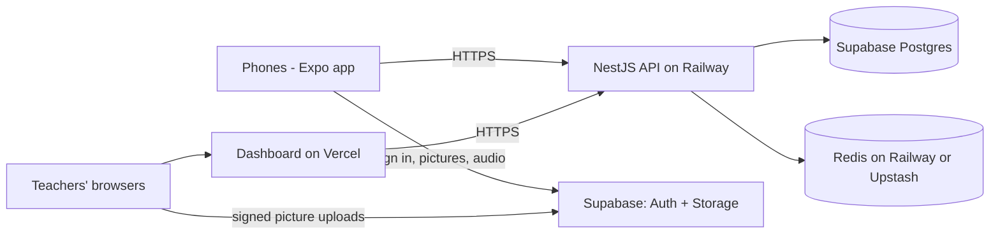

# Deployment

## Yes, the API has to be online
The app runs on students' phones, so anything it talks to must be reachable on the internet: the NestJS API, the database, auth and file storage. Supabase already hosts the database, auth and storage for you. **The only thing you deploy yourself is the NestJS API**, and Railway is a good fit for it.



## Environments
| Environment | Purpose | Where |
|---|---|---|
| Local | Development | API on your computer (`pnpm --filter api start:dev`), a free Supabase dev project, Redis in Docker |
| Staging | Testing builds with real phones before release | Railway service `api-staging` + a separate Supabase project |
| Production | Real students | Railway service `api-prod` + the production Supabase project |

Never point a development build at the production database.

## Deploying the API to Railway

**Ready to go:** `railway.json` at the repo root sets the build (`pnpm turbo run build --filter=api`, which also builds `packages/shared` and generates the Prisma client), the start command (`node apps/api/dist/main.js`), migrations before each deploy (`prisma migrate deploy`) and the `/health` check. In Railway, keep the service's root directory at the **repo root**: the API needs `packages/shared` to build. The steps below explain each part; with `railway.json` you mostly just add the environment variables (step 5).

1. **Add a health check** to the API: `GET /health` returns `{ "ok": true }`.
2. **Add a `Dockerfile`** in `apps/api` (or let Railway's builder detect Node). It should build `packages/shared` and then the API (`pnpm turbo run build --filter api`, which also runs `prisma generate`), and start with `node dist/main.js`. The server must listen on `process.env.PORT`.
3. **Create a Railway project** → "Deploy from GitHub repo" → select the repo. Set the service's root directory to `apps/api` (or the build settings for your monorepo).
4. **Add Redis** from Railway's template, or use Upstash.
5. **Set environment variables** in Railway (never commit these):
   ```
   DATABASE_URL=            # Supabase pooled connection string
   DIRECT_URL=              # Supabase direct connection (for migrations)
   SUPABASE_URL=            # the API verifies user tokens against <SUPABASE_URL>/auth/v1/.well-known/jwks.json
   SUPABASE_SERVICE_ROLE_KEY=   # server only, never in the app
   REDIS_URL=
   SENTRY_DSN=
   NODE_ENV=production
   CORS_ORIGINS=            # the admin site's URL
   ```
6. **Run migrations on deploy** with `npx prisma migrate deploy` as a pre-deploy or release command, never `migrate dev` in production.
7. **Set the health check path** to `/health` so Railway only switches traffic when the new version is up.
8. **Add a custom domain** such as `api.blurt.app`. Railway provides HTTPS automatically.
9. **Point the app at it** with `EXPO_PUBLIC_API_URL=https://api.blurt.app` in the production EAS build profile.

Every push to `main` then deploys automatically. Use a `staging` branch for the staging service.

## Deploying the teacher dashboard
1. On Vercel, import the repo and set the project root to `apps/dashboard`.
2. Environment variables: `NEXT_PUBLIC_API_URL`, `NEXT_PUBLIC_SUPABASE_URL`, `NEXT_PUBLIC_SUPABASE_ANON_KEY` (the anon key is safe for browsers; the service-role key never is).
3. Custom domain, e.g. `teach.blurt.app`, and add it to the API's `CORS_ORIGINS`.
4. In Supabase Storage, create a `pictures` bucket: uploads only through signed URLs from the API, public read for processed images only.
5. The API also runs the **worker** for picture processing and pronunciation audio. On Railway, add it as a second service from the same code with start command `node dist/worker.js`, sharing the same environment variables.

## Sign-in email (Supabase Auth)
Students sign in with their email and a 6-digit code. The branded email is `supabase/templates/magic-link.html`. Paste it into **two** templates under **Supabase → Authentication → Emails → Templates**: **Magic Link** (returning students) and **Confirm signup** (a brand-new email address gets this one instead). `{{ .Token }}` is the code. The default Confirm signup email contains a link, not a code, so without this step new students can't sign in. Suggested subject for both: `Your Blurt! sign-in code`. If sending fails ("Error sending confirmation email" / "Error sending magic link email", HTTP 500), check **Logs → Auth** for the reason: usually wrong custom SMTP settings, a template that doesn't render, or the built-in sender's hourly limit. Do the same for the staging and production projects. The email says the code expires in 1 hour, so keep **Authentication → Providers → Email → Email OTP expiration** at 3600 seconds, or change the sentence to match. Supabase's built-in email service only sends a few emails per hour: connect your own SMTP provider (Authentication → Emails → SMTP settings) before a classroom pilot.

## Costs
Railway and Supabase both have free or low-cost starting tiers and usage-based paid plans, which change over time, so check their pricing pages. Watch two things: keep one small API instance until real traffic needs more, and use Supabase's connection pooler so the API doesn't run out of database connections.

## The no-server option
To launch the very first version without deploying anything yourself, use **Supabase only**: Postgres + Auth + Storage + **Edge Functions** (small TypeScript functions that Supabase hosts). The answer checking (`/rounds/:id/attempts`) becomes an Edge Function that imports the same matcher from `packages/shared`. Move to NestJS on Railway when you add leagues, teacher accounts and background jobs.

## Release checklist
- [ ] `/health` is green on staging, and a full round works on a real phone against staging.
- [ ] Migrations ran without errors.
- [ ] Sentry receives a test error from the API and from the app.
- [ ] Rate limits are on for attempts and sign-in.
- [ ] Database backups are enabled in Supabase.
- [ ] A teacher can upload a picture, draw the highlight, publish, and a student in their class sees it in the app.
- [ ] A second teacher account cannot open the first teacher's topics (403).
- [ ] Production secrets differ from staging secrets.
